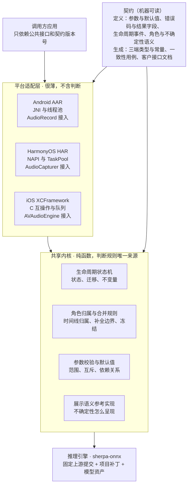
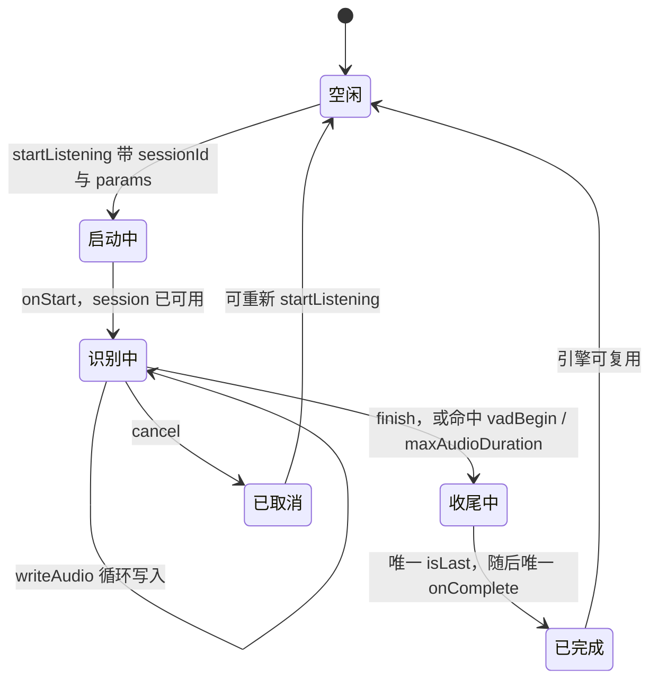
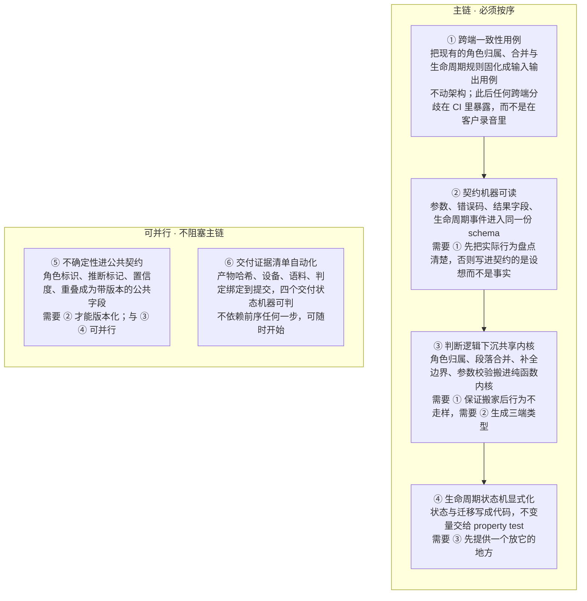

# AmphionRuntime SDK 目标形态

2026-10-19

> 本文描述我们希望 AmphionRuntime SDK 成为什么样子，作为架构讨论与演进排序的基准。它描述目标形态，不作为现状评估。

## 什么叫健康

健康的 SDK 是一台别人能放心嵌进自己产品里的机器：它对外承诺的每一条行为都能被机器验证，它最难的判断只存在一处，它在不确定的时候说得出自己不确定。

这三件事互相支撑。承诺可验证，才敢只写一处；只写一处，三端行为才会一致；行为一致，不确定性才有资格作为公共语义交付给调用方，而不是每端各自解释一遍。

目标形态可以用四个能回答是或否的问题检验：

1. 调用方只读一份契约，能不能写出三端都能跑的代码？
2. 任意一条行为承诺，能不能在 CI 里以失败的形式表达出来？
3. 同一段音频灌进三端，公开输出能不能逐字节一致？
4. SDK 不确定的时候，调用方能不能只看返回值就知道？

四个都是「能」，这个 SDK 就是健康的。下面九节分别描述达到这个状态时各部分是什么样子，不描述路径；路径只在最后一节。

## 契约即代码

契约是一份机器可读的文件，人手写的接口文档数量为零。参数、错误码、结果字段、生命周期事件和角色语义在这里定义一次，其余一切都是它的输出。

应该由契约生成的东西：

| 产物 | 内容 |
| --- | --- |
| 三端类型与常量 | Kotlin / ArkTS / Swift 的参数类、结果类、错误码枚举 |
| 客户接口文档 | 按客户与平台渲染的 Markdown，内容不可手改 |
| 参数校验 | 范围、互斥、依赖关系的校验代码 |
| 一致性测试 | 三端必须通过的同一套用例 |
| 诊断事件表 | 结构化日志的事件名与字段 |

契约里的一条行为承诺有三个层次，缺一不可：自然语言的意图（人读）、形式化的条件（机器读）、以及一组能证伪它的用例。写不出用例的承诺不进契约，说明它还没想清楚。

契约有版本。客户拿到的每个 SDK 包都带着它实现的契约版本号，两个版本间的差异是生成的，不是人回忆出来的。调用方升级前能先看到自己需要改什么。

契约改动的流程是单向的：先改契约，再跟实现。实现先走一步会被 CI 拦住，因为生成的类型里没有那个字段。

## 核心逻辑只写一次

一条判断规则只存在一个地方。判断规则指那些决定输出对不对的东西：角色归属、段落合并、补全边界、生命周期迁移、参数校验。

划分原则只有一条：需要平台 API 才能完成的工作归适配层，其余全归内核。录音采集、线程调度、文件路径、权限申请属于前者；角色归属、状态迁移、参数校验属于后者。

内核是纯函数，这带来两个具体好处。它可以用文本用例全量覆盖，不需要设备、音频和模型；它的输出是确定的，所以三端不一致会在 CI 里暴露，而不是在客户录音里暴露。

判断这一层是否真的成立，用接入第四个平台的成本来量：如果只需要写类型转换和回调投递，就成立了。

## 生命周期是一台显式状态机

生命周期是一个写出来的状态机，不是一组回调约定。它有命名的状态、明确的迁移条件，以及一组任何路径上都恒真的断言。

| 状态 | 含义 |
| --- | --- |
| 空闲 | 无会话；可调用 startListening |
| 启动中 | session 已发布，onStart 未回 |
| 识别中 | writeAudio 循环写入；中间结果与句末 isFinal |
| 收尾中 | finish 已调用，或自动结束命中；等待本会话唯一的 isLast |
| 已完成 | onComplete 已回，引擎可复用 |
| 已取消 | 不再产生 final 或 complete；可重新 startListening |

必须恒真的四条：

- onStart 之前 session 已可用：回调内同步 writeAudio、finish、cancel 都不报 NOT_LISTENING
- 正常结束的会话恰好一次 isLast，之后恰好一次 onComplete；cancel 生效后不再新增
- 每次自动结束都能归因到具体条件：vadBegin、maxAudioDuration 或调用方 finish
- Runtime 释放不得越过活跃会话的 native 异步工作，等待期间不创建新会话

状态机写在共享内核里，三端共用。平台层只负责把外部调用翻译成输入事件，把状态机的输出事件翻译成回调，自己不做任何「现在该不该发」的判断。

验证方式随之改变。不变量用随机事件序列跑 property test，在内存里以秒为单位覆盖几十万条路径；真机长测留给它真正能回答的问题——音频采集、功耗、热、长时稳定性。

这台状态机也是诊断的骨架。每一次迁移都是一条结构化事件，带触发原因和当时的关键参数，所以「为什么提前结束了」这类问题能直接从事件时间线读出来。

## 不确定性是一等公民

诚实是这个 SDK 最值钱的属性，所以它必须是公共 API 里的类型字段，而不是文档里的一句说明。调用方不应该需要读我们的工程文档才知道哪些结果是猜的。

每一条输出都能回答四个问题，回答来自返回值本身：

| 问题 | 承载字段 |
| --- | --- |
| 这是谁说的？ | 角色标识，不知道就是 UNKNOWN |
| 这个判断有多确定？ | 置信度，推断得来的置 0 |
| 这是听到的还是推出来的？ | 推断标记，带推断依据 |
| 这段时间是不是有人说话？ | 重叠标记，不吸掉 |

四条硬规则：

- 不知道就输出不知道。UNKNOWN 是一个合法结果，不是一个需要被消灭的指标。
- 推测始终可辨认。由规则补全的身份带标记、带边界、带依据，调用方可以选择不用。
- 定稿即冻结。已经交给调用方的结果不被迟到的信息改写，纠错只能以新结果的形式出现。
- 不补假数。没有真实音频证据时字段缺省，而不是填上一句的分数或一个安全值。

这套语义的价值在于它把阈值决策权交回业务方。SDK 负责说清自己有多确定，业务方根据场景决定多少算够；警务核查和会议转写的取舍不同，这不应该由 SDK 替他们做。

配套的是一份官方展示语义：按原句还是按角色分段、混合角色怎么写、推断和重叠怎么标。它不是强制的，但它是默认的，因为一个不确定性语义在展示层被忽略，等于没有。

## 可自证

当客户说「这段识别不对」时，SDK 自己就能说清当时发生了什么，不需要工程师带着调试版回现场。这是交付型 SDK 和内部库的分界线。

诊断能力是一个独立于主 SDK 的面，客户可以不集成，但集成了就能导出一份自包含的事件时间线：生命周期迁移、生效参数、写入 PCM 时长、终止条件归因、角色窗口提交点、模型与授权指纹。

两条设计原则：

- 每一条自动行为都能归因。会话自动结束时，事件里写着是哪个条件触发的及其当时的阈值和计时。
- 诊断不泄露内容。事件里有时长、能量、判定和哈希，没有 PCM、没有识别文本、没有 embedding。

交付侧对应的形态是：每个包带一份签名的证据清单，把代码、二进制、设备、语料和判定绑在一起。于是下面四个状态是机器可判的，而不是描述性的措辞：

| 状态 | 成立条件 |
| --- | --- |
| 构建完成 | 产物哈希已绑定到确定的提交 |
| 验收通过 | 该哈希上的必要门禁全部有通过记录 |
| 已发布 | 客户可见渠道上存在该哈希 |
| 归档完成 | 远端回下载校验通过且索引可检 |

证据绑定在哈希上，所以复用是安全的：同一个二进制、同一台设备、同一段录音的结论不需要重跑。改动使哈希变化时，失效的证据范围是算出来的。

## 调用方体验

一个没见过这个 SDK 的工程师，十行代码内拿到第一条识别结果。它是整个 SDK 质量最敏感的指标，因为做不到这一点通常意味着必填参数太多或失败不可解释。

四个应该成立的条件：

1. **默认值能跑。** 只给 sessionId 和音频格式就能开始，其余参数都有经过验证的默认值。
2. **跨端零平台分支。** 同一份参数名和语义在三端通用，平台特有能力放在明确标记的扩展区。
3. **错误自带修复路径。** 错误返回的不只是码和消息，还包括哪个参数、当前值、合法范围。
4. **渐进式复杂度。** 声纹、角色分离、热词全是可选开关，不开就不影响主流程也不影响包体。

失败必须显式。某个能力在该平台暂未实现时，调用会明确报错，而不是静默忽略后让调用方在结果里猜。静默降级比报错贵得多。

Demo 是契约的参考实现，不是演示程序。客户拿到的 Demo 源码就是我们认为正确的用法：它展示了不确定性该怎么展示、回调该怎么归并、错误该怎么处理，三端 Demo 展示语义一致。

升级成本可预测。每个版本的升级说明回答同一个问题：调用方必须改什么、行为有什么变化、什么没变。没有变更时也明确写出没有。

## 版本与承诺

调用方能分清哪些东西永远不会变、哪些会随版本演进。这条界线比具体的兼容策略更重要，因为它决定了对方敢把多少东西建在我们上面。

| 层次 | 承诺 |
| --- | --- |
| 冻结 | 接口形状、生命周期不变量、已发布错误码语义、离线边界 |
| 演进 | 识别精度、角色算法、模型、性能、新增可选字段 |
| 实现细节 | 模块划分、缓存策略、线程模型、日志文本 |

精度属于可演进层，但演进有方向：同一评测集上不得回退。精度变更随包附带对照数据，调用方能看到自己在意的场景是变好了还是持平。

弃用是一个过程，不是一次删除。字段和错误码只标弃用、不移除；弃用同时给出替代路径和一个带日期的窗口，窗口内新旧双跑。

离线与隐私是不谈条件的硬边界，它不是一个配置项：

- 识别、声纹、Speaker VAD、角色分离全部在端侧完成。
- 不上传 PCM、文本或 embedding，不要求调用方配置任何服务地址。
- 运行时零网络请求是一条可测量的承诺，每个包都有对应证据。

这条边界的价值随时间增长。它让这个 SDK 能进入那些云方案永远进不去的场景，而这是存端侧运行时的根本理由。

## 健康度指标

目标形态应该能被测量，否则它只是一组形容词。下面六条都是可以在 CI 或命令行里算出来的数字。

| 指标 | 目标值 |
| --- | --- |
| 手写接口文档份数 | 0 |
| 三端行为逻辑的重复实现份数 | 1 |
| 跨端一致性用例通过率 | 100% |
| 契约行为承诺中有对应用例的比例 | 100% |
| 新工程师拿到第一条结果的代码行数 | ≤ 10 |
| 新平台接入所需的行为逻辑量 | 0 |

最后一条是其余几条的汇总检验。当接入第四个平台只需要写类型转换和回调投递，不需要重实现任何判断规则时，内核与适配层的分层就是真的成立了。

还有两个不好量化、但很容易感知的信号：

- 客户报一个问题时，第一反应是要诊断导出，而不是要音频和复现步骤。
- 回答「这个行为是什么」时，大家指向同一份文件，而不是各自讲一个版本。

## 演进顺序

顺序按依赖排，不按价值排。最值钱的那一步往往不是能先做的那一步，而前面的地基没打好时，后面的改造无法证明自己没有弄坏东西。

① 是整个序列的关键，因为它是唯一一个不改架构就能完成、却让后续每一步变得可验证的步骤。没有它，内核下沉的收益无法证明，重构也就不敢做。

每一步都应该能独立停下。做完 ① 就停，仓库比现在健康；做完 ② 再停，依然成立。没有哪一步要求先停下所有交付再整体重构。

最后说明一点：这份文档描述的是目标，不是排期。每一步的范围、代价和时机要放在真实的交付节奏里单独判断。
